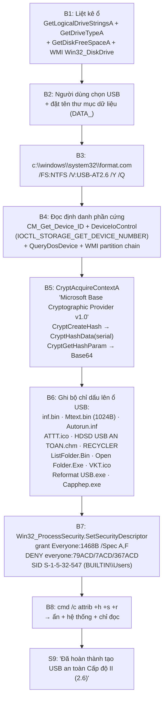

### E-004

- severity: info
- status: validated
- repro_command: `python work\strx.py "ext\USB\app\USB_ATTT.exe" both > work\strings_USB_ATTT.txt` (offline — no execution, static string extraction only)
- content_hash: b9c03926a8185f72744affd8134ca0580d32076a8f91e8cd451b18c3883e80b7
- artifact_path: ext/USB/app/USB_ATTT.exe
- linked_workitem: WI-003
- notes: Offline static analysis of the VB6 native-compiled binary. Extends the original E-003 record with full API import and process reconstruction.

# E-004 — USB_ATTT.exe (VB6): phân tích sâu quy trình tạo USB an toàn 2.6

- **severity**: info
- **status**: validated
- **repro_command**: `python work\strx.py "ext\USB\app\USB_ATTT.exe" both > work\strings_USB_ATTT.txt` (offline)
- **content_hash**: `b9c03926a8185f72744affd8134ca0580d32076a8f91e8cd451b18c3883e80b7`
- **artifact_path**: `ext/USB/app/USB_ATTT.exe`
- **supersedes**: bổ sung cho `E-003.md` (bản gốc) — toàn bộ nội dung đã được mở rộng ở đây

> Bổ sung cho E-003: bằng chứng import/API đầy đủ + tái dựng quy trình thao tác.

---

## 1. Danh tính (bổ sung)

| Thuộc tính | Giá trị |
|---|---|
| Section | `.text` VA=0x1000 VS=0x6F7C4 raw=0x1000 rawsz=0x70000 entropy=5.89 |
| | `.data` VA=0x71000 entropy=0.00 · `.rsrc` VA=0x74000 entropy=2.36 |
| EntryPoint | `0x54DC` |
| Overlay | none |
| VB runtime API dùng | `__vbaFileOpen`, `__vbaFileClose`, `DllFunctionCall`, `__vbaLateMemCallLdRf` (⇒ khai báo API động) |

---

## 2. API nhập — bằng chứng cho từng bước của quy trình

VB6 khai báo API động qua `DllFunctionCall`; các tên sau nằm trong bảng chuỗi (offset RVA):

### 2.1 Liệt kê & nhận diện thiết bị

```
0x18D8C  kernel32.dll
0x18DA0  GetLogicalDriveStringsA
0x18DF0  GetDriveTypeA
0x18E4C  GetDiskFreeSpaceA
0x18E98  SetFilePointerEx
0x18EE4  ReadFileEx
0x18F28  WriteFileEx
0x18F6C  GetVolumeInformationA      ← đọc serial + label hiện tại của volume
0x19018  LockFileEx
0x1905C  UnlockFileEx

0x19FC4  CM_Get_Device_ID_Size       (cfgmgr32)
0x1A014  CM_Get_Parent               (cfgmgr32)
0x1A05C  DeviceIoControl            ← IOCTL_STORAGE_GET_DEVICE_NUMBER
0x1A0D8  shlwapi
0x1A118  setupapi
0x1A128  SetupDiDestroyDeviceInfoList
0x1A190  SetupDiEnumDeviceInfo
0x1A1E0  SetupDiEnumDeviceInterfaces
0x1A234  SetupDiGetClassDevsA
0x1A284  SetupDiGetDeviceInstanceIdA
0x1A2D8  SetupDiGetDeviceInterfaceDetailA
0x1A35C  SetupDiGetDeviceRegistryPropertyA
0x1A494  QueryDosDeviceA
0x1A4DC  setupapi.dll
0x1A4F0  SetupDiCreateDeviceInfoList
0x1A44C  FormatMessageA
```

⇒ **Đầy đủ bộ API CfgMgr32/SetupAPI** để duyệt cây thiết bị USB, lấy `PNPDeviceID` (chứa
serial phần cứng), ánh xạ ký tự ổ → partition → disk.

WMI (nội dung truy vấn nhúng trong binary):

```sql
SELECT Caption, DeviceID,PNPDeviceID FROM Win32_DiskDrive
ASSOCIATORS OF {Win32_DiskDrive.DeviceID='...'}   WHERE AssocClass = Win32_DiskDriveToDiskPartition
ASSOCIATORS OF {Win32_DiskPartition.DeviceID='...'} WHERE AssocClass = Win32_LogicalDiskToPartition
```

### 2.2 Băm & sinh chữ ký (Cryptography)

```
0x18664  AdvAPI32.dll
0x18678  CryptAcquireContextA
0x186DC  CryptReleaseContext
0x18728  CryptCreateHash
0x18770  CryptDestroyHash
0x187BC  CryptHashData
0x18804  CryptGetHashParam
```

Provider (chuỗi `0x8860`): **`Microsoft Base Cryptographic Provider v1.0`**

Alphabet Base64 (`0x88C8`): `ABCDEFGHIJKLMNOPQRSTUVWXYZabcdefghijklmnopqrstuvwxyz0123456789+/`
Chuỗi seed (`0x9988`, `0x99C4`): `abcdefghijklmnopqrstuvwxyz` + `0123456789`

⇒ `inf.bin` và `Mtext.bin` là **hash (Base64) của định danh thiết bị** (serial / PNP ID),
KHÔNG phải mã hoá dữ liệu người dùng.

### 2.3 Gán quyền (ACL) — qua WMI, không dùng icacls

VB6 late-binding error string: `objFileSecSetting.ExecMethod_("SetSecurityDescriptor", objInParam)`
WMI class: **`Win32_ProcessSecurity`** (method `SetSecurityDescriptor`)
SID nhóm BUILTIN\Users: `S-1-5-32-547` (`0x9500`)

Bảng tham số ACL (UTF-16, offset `0x9C0C` – `0xA98C`):

```
 /g  everyone:1468B  /Spec A    (0x9CF0)  grant Everyone R/W/X/Delete/ReadPerms  — tập tin
 /g  everyone:1468B  /Spec F    (0x9D30)  grant tương tự                        — thư mục
 /g  everyone:148B   /Spec G    (0x9F80)  grant rút gọn                          — thư mục con
 /e /d everyone:79ACD /Spec A    (0x9FB8)  DENY  (79ACD)                         — tập tin
 /e /d everyone:7ACD  /Spec F    (0x9FF8)  DENY  (7ACD)                          — thư mục
 /e /d everyone:367ACD /Spec G   (0xA038)  DENY  (367ACD)                        — thư mục con
 /g  everyone:X      /Spec G    (0xA858)  grant Everyone:Full                    — thư mục con
 /e /d everyone:235679ACD /Spec G (0xA88C) DENY
 /g  everyone:1468B  /Spec G    (0xA8D4)
 /e /d everyone:23579AC  /Spec G (0xA910)
 /g  everyone:468B   /Spec A    (0xA954)
 :1234568B   /Spec A  (0x9C74)
 :12345689B  /Spec F  (0x9C9C)
 :124589B    /Spec G  (0x9CC8)
 /e   (0x9C64)   /e /  (0x9C30)   /e /g  (0x9C1C)   /g  (0x9C0C)
 USERNAME  (0x9C40)   :12  (0x9C58)   KRBTGT  (0x9A1C)   jAccessMask  (0x9B86)
```

**Diễn giải theo `icacls` syntax:**

| Mã | Nghĩa |
|---|---|
| `1468B` | 0x1 Read + 0x2 Write + 0x4 Execute + 0x8 ReadEA + 0x40 WriteEA + 0x100 Delete + 0x400 DeleteChild + 0x800 ReadPermissions ⇒ **Full R/W + xoá + đổi quyền cho Everyone** |
| `79ACD` / `7ACD` / `367ACD` | Quyền **DENY** (D) trên tập tin / thư mục / thư mục con |
| `/Spec A` / `F` / `G` | Áp dụng cho file / folder / folder con |
| `S-1-5-32-547` | BUILTIN\Users |
| `KRBTGT` | kiểm tra tài khoản dịch vụ (Kerberos) |

**Hiệu ứng thực tế**: user thường **không xoá được** `inf.bin`/`Mtext.bin`; kể cả admin cũng cần
bỏ deny trước. Đây là lớp phòng thủ thứ hai sau checksum.

### 2.4 Thuộc tính tệp & format

```
0xA820  cmd /c attrib +h +s +r          → Hidden + System + Read-only
0x185B8 attrib +R +H +S                 → biến thể
0xA07C  c:\windows\system32\format.com
0xA0C0  /FS:NTFS /V:
0xA0E0  /Y
0xA0F0  /Q                              → Quick Format
```

### 2.5 Tham chiếu Certificate Store (chưa xác định mục đích)

```
0x87AC  {53F56307-B6BF-11D0-94F2-00A0C91EFB8B}   CLSID My (cert store)
0x8800  {F18A0E88-C30C-11D0-8815-00A0C906BED8}   CLSID Root
```

### 2.6 Chuỗi hex mẫu (dữ liệu sinh ra, có thể là serial mẫu)

```
0x8600  F66C4EAE617BFC2024F680447BF8953457C8D698618C6F3D032991C71298C7B8
0x86E8  E388E57043D45B478B0191312E4A5C1A4E98E0F53EAA4F70C5AACE06B56B2583
```

---

## 3. Thông điệp giao diện (đã giải mã TCVN3/VNI)

```
CHU7O7NG TRI2NH TA5O USB AN TOA2N  (Ca61p d9o65 II - 2.6)
   → "CHƯƠNG TRÌNH TẠO USB AN TOÀN (Cấp độ II - 2.6)"

- Ha4y cho5n USB ca62n ta5o:
   → "- Hãy chọn USB cần tạo:"
  Chu1 y1: mo5i tha81c ma81c xin gu73i ve62 Pho2ng ATTT 069.536526
   → "Chú ý: mỗi thao tác mãc xin gửi về Phòng ATTT 069.536526"
     (★ mỗi lần dùng USB_ATTT đều báo cho Phòng ATTT — cơ chế kiểm soát chặt chẽ)

- Ha4y d9a85t te6n thu7 mu5c du74 lie65u:   DATA_
   → "- Hãy đặt tên thư mục dữ liệu:"
  USB-AT2.6
   → "- Hãy đặt tên USB an toàn này:"
   ★ đây chính là LABEL của volume được đặt qua format.com /V:

- Chuong tri2nh na2y giu1p ba5n thie61t la65p (ta5o) USB tho6ng thu7o72ng
  tha2nh USB ba3o d9a3m an toa6n tho6ng tin ho7n - tu7o7ng u71ng vo71i
  Ca61p d9o65 an toa6n tho6ng tin la2 Ca61p d9o65 II (2.6).
   → "- Chương trình này giúp bạn thiết lập (tạo) USB thông thường thành USB
      bảo đảm an toàn thông tin hơn - tương ứng với Cấp độ an toàn thông tin
      là Cấp độ II (2.6)."

- USB an toa2n Ca61p d9o65 II na2y se4 bi5 ma61t ti1nh na8ng an toa6n tho6ng tin
  khi su3 du4ng tre6n he65 d9ie62u ha2nh ngoa2i Windows hoa85c bi5
  d9i5nh da5ng (format) la5i ba82ng he65 d9ie62u ha2nh.
   → "- USB an toàn Cấp độ II này sẽ MẤT tính năng an toàn thông tin khi sử dụng
      trên hệ điều hành ngoài Windows hoặc bị định dạng (format) lại bằng
      hệ điều hành."

  Ta61t ca3 ca1c ta2i khoa3n d9e62u co1 quye62n d9o5c va2 ghi.
  Chi3 ta2i khoa3n <ten> tre6n ma1y d9u7o75c quye62n ta5o thu7 mu5c va2 lu7u ta65p tin.
  Ta2i khoa3n kha1c va2 ma1y kha1c d9u7o75c d9o5c, kho6ng d9u7o75c ghi the6m du74 lie65u hoa85c xo1a.
  Cac ta2i khoa3n kha1c chi3 co1 quye62n d9o5c.
   → "Tất cả các tài khoản đều có quyền đọc và ghi. Chỉ tài khoản <tên> trên máy được
      quyền tạo thư mục và lưu tập tin. Tài khoản khác và máy khác được đọc,
      không được ghi thêm dữ liệu hoặc xoá. Các tài khoản khác chỉ có quyền đọc."

  d9u7o75c quye62n ghi du74 lie65u
   → "(được quyền ghi dữ liệu)"
  Dinh dang nhanh (Quick format) USB an toan !
   → "Định dạng nhanh (Quick format) USB an toàn !"
  Da hoan thanh tao USB an toan Cap do II (2.6)!
   → "Đã hoàn thành tạo USB an toàn Cấp độ II (2.6)!"

  Tat mang, chuong trinh se chay nhanh hon...   → "Tắt mạng, chương trình sẽ chạy nhanh hơn..."
  Vui long cho trong khi chuong trinh thuc hien... → "Vui lòng chờ trong khi chương trình thực hiện..."
```

---

## 4. Quy trình tái dựng (từ UI + API + thứ tự chuỗi)



---

## 5. Đối chiếu 1-1 với bộ kiểm tra của MiAV

| USB_ATTT tạo ra | MiAV `GetTypeUSB` đếm/so | Chuỗi tại VA (MiAV) |
|---|---|---|
| `Autorun.inf` | `autorun.inf` | `0x9151DC` |
| `ATTT.ico` | `attt.ico` | `0x915300` |
| `inf.bin` | `inf.bin` | `0x9152E4` |
| `Mtext.bin` | `mtext.bin` | `0x915238` |
| `RECYCLER` | `recycler` | `0x9151BC` |
| `HDSD USB AN TOAN.chm` | `hdsd usb an toan.chm` | `0x915200` |
| `VKT.ico` | `vkt.ico` | `0x915258` |
| `Reformat USB.exe` | `reformat usb.exe` | `0x915274` |
| `DATA_` (thư mục dữ liệu) | `data` | `0x9151A4` |
| label `USB-AT2.6` | magic `0x120116` | `0x915061`, `0x91423E` |
| *(do Windows tạo)* | `system volume information` | `0x9152A4` |
| *(không có)* | `umzfe*.exe`, `protect.exe`, `cpfile.exe`… | `0x9149C8`–`0x914AE8` (nhánh CY, **không phải USB an toàn**) |

⇒ **Bộ 5 chỉ dấu bắt buộc** (`[ebp-0x280] == 5`) chính xác là:
`inf.bin` + `mtext.bin` + `autorun.inf` + `recycler` + `attt.ico` — đều do `USB_ATTT.exe` sinh ra.

---

## 6. Điểm yếu (bổ sung cho F-02 / F-04)

1. **Nhãn volume là dữ liệu người dùng sửa được** — `label E: USB-AT2.6` bằng cmd là đủ.
2. **Bộ chỉ dấu là tên file thuần** — chỉ cần tạo 5 file rỗng với đúng tên là qua được
   tầng đếm (tầng `CheckFileUSB` + magic 20 byte mới chặn lại).
3. **Magic 20 byte là hằng số cứng** — `0x120089/0x120116/0x1200a0/0x1f01ff` nằm thẳng trong
   `.text` của MiAV, không có chữ ký số ⇒ về lý thuyết có thể dựng lại.
4. **`public.pem` (451 byte) trong bộ MiAV** — RSA public key 451 byte = 2048-bit PKCS#1.
   Nhiều khả năng dành cho việc verify chữ ký của `data.db` hoặc `public.pem` payload,
   **nhưng KHÔNG được dùng trong đường kiểm tra USB** (đường này chỉ so 20 byte hằng số).
   ⇒ Đây là cơ hội nâng cấp: dùng RSA thay cho bảng hằng số.
5. **ACL không chống được admin** — admin gỡ deny ACE rồi xoá file trong 30 giây.

**Confidence: HIGH** cho danh sách file/ACL/label/quy trình; **MEDIUM** cho thuật toán băm
(cần dynamic trace `CryptHashData` để xác nhận thuật toán và đầu vào chính xác).