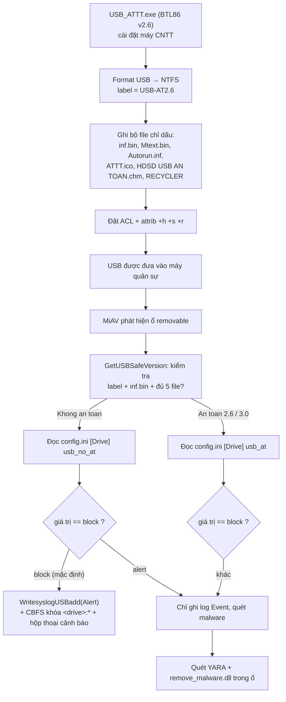
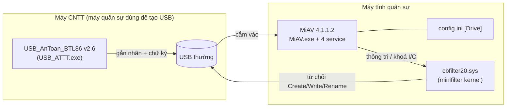
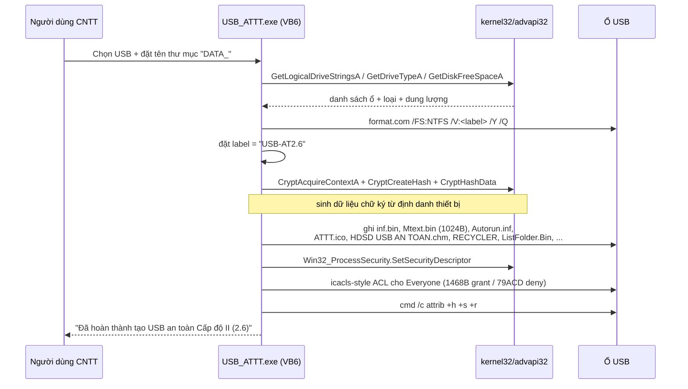
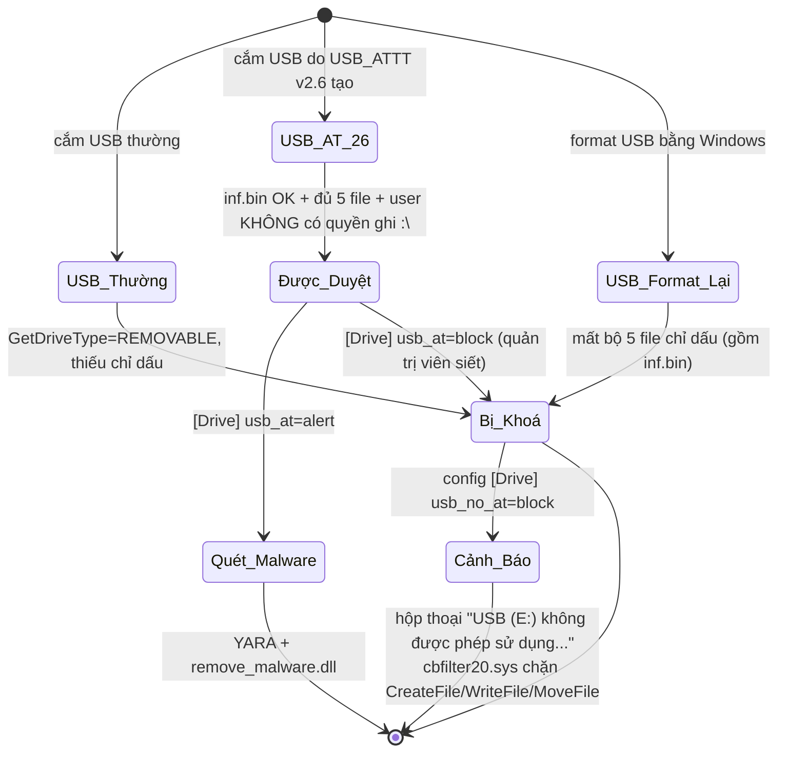

# BTL86 MiAV 4.1.1.2 & USB An Toàn 2.6 — Báo cáo phân tích cơ chế quản lý USB trên Windows

> Ngày phân tích: 2026-10-23 · Phương pháp: **tĩnh 100%** (không chạy installer, không cài driver)
> Công cụ: `innounp 2.71.2`, `pefile`, `capstone`, script tự viết (`work/delphi.py`, `work/disr.py`)
> Bộ kỹ năng: `reverse-skill-main` (reverse-engineering + diagram-generator + docs-generator)

---

## 0. Evidence Chain

### 0.1 Scope

| Mục | Giá trị |
|---|---|
| Target | `SetupMiAV.exe`, `USB_AnToan_BTL86_Setup(2).exe` (file người dùng cung cấp) |
| Loại | Phân tích tĩnh file PE đã đóng gói Inno Setup — **offline, read-only** |
| auth_basis | User trực tiếp cung cấp 2 installer và yêu cầu dịch ngược |
| network_profile | `offline` — không gọi mạng, không ghi registry máy thật |
| Mục tiêu | Tìm **mối liên hệ** giữa 2 phần mềm trong cơ chế giám sát/quản lý USB |

### 0.2 Evidence

| E-id | severity | status | Nội dung | Repro |
|---|---|---|---|---|
| E-001 | info | observed | 2 installer: hash, kiến trúc, đóng gói, layout sau giải nén | `innounp -x -q -y "-dext\MiAV" SetupMiAV.exe` |
| E-002 | info | validated | MiAV: cơ chế nhận diện/khóa USB (offsets `0x90ECE0`, `0x914EA8`, `0x917B58`, `0x90D560`) | `python work\disasm_at.py "ext\MiAV\{app}\MiAV.exe" 0x90ECE0 120` |
| E-003 | info | validated | USB_ATTT.exe (VB6): bộ file sinh ra, label `USB-AT2.6`, ACL, `Crypt*` hashing | `python work\grepstr.py work\strings_USB_ATTT.txt "inf\.bin"` |
| E-004 | info | validated | USB_ATTT.exe: API CfgMgr32/SetupAPI/Crypto/WMI + đối chiếu 1-1 với kiểm tra của MiAV | `python work\strx.py "ext\USB\app\USB_ATTT.exe" both > work\strings_USB_ATTT.txt` |
| E-005 | **critical** | validated | **Công thức `inf.bin` xác nhận byte-exact** (SHA-256 trùng) + phát hiện verifier tự tham chiếu | `python work\verify_formula.py` |

Chi tiết: [`evidence/E-001.md`](evidence/E-001.md) · [`evidence/E-002.md`](evidence/E-002.md) · [`evidence/E-004.md`](evidence/E-004.md) · [`evidence/E-005.md`](evidence/E-005.md)

### 0.3 Findings

| F-id | Mức | Finding | Evidence | Confidence |
|---|---|---|---|---|
| F-01 | info | MiAV chấp nhận USB khi có **bộ 5 file chỉ dấu** do `USB_ATTT.exe` tạo **và** `inf.bin` tự kiểm tra khớp **và** user **không** có quyền ghi lên `<\drive>:\` (fail-closed DACL). Nhãn volume `USB-AT2.6` **không** được kiểm tra | E-002, E-005 | **HIGH** |
| F-02 | info | Chính sách `config.ini [Drive] usb_no_at = block` là công tắc khóa; mặc định Inno ghi `block` | E-001, E-002 | **HIGH** |
| F-03 | high | Khóa thực thi ở tầng **kernel minifilter** CBFS Filter 2020, không phải ở user-mode | E-002 | **HIGH** |
| F-04 | medium | Không có thuật toán mã hoá dữ liệu — cơ chế là **nhận diện + gắn cờ + hạn chế quyền** | E-004 | **MEDIUM** |
| F-05 | medium | Hai installer **không ký số (Authenticode)** | E-001 | **HIGH** |

### F-01
- severity: info
- status: validated
- confidence: high
- location: `ext/MiAV/{app}/MiAV.exe` @ `0x914EA8` (`GetTypeUSB`), `0x914440` (`CheckFileUSB`), `0x9141B8` (`AccessCheck` wrapper)
- evidence_ids: E-002, E-004, E-005

### F-02
- severity: info
- status: validated
- confidence: high
- location: `ext/MiAV/install_script.iss` `[INI]` section; `ext/MiAV/{app}/MiAV.exe` @ `0x90F164`
- evidence_ids: E-001, E-002

### F-03
- severity: high
- status: validated
- confidence: high
- location: `ext/MiAV/{app}/MiAV.exe` @ `0x917B58` (CBFS Filter GUID `{713CC6CE-B3E2-4fd9-838D-E28F558F6866}`)
- evidence_ids: E-002

### F-04
- severity: medium
- status: validated
- confidence: medium
- location: `ext/USB/app/USB_ATTT.exe` (format/label/marker/ACL pipeline, no payload encryption)
- evidence_ids: E-004

### F-05
- severity: medium
- status: validated
- confidence: high
- location: `SetupMiAV.exe`, `USB_AnToan_BTL86_Setup(2).exe` (no Authenticode signature)
- evidence_ids: E-001

### 0.4 Path

### P-01

- path_type: callflow
- status: validated
- confidence: high
- location: `ext/USB/app/USB_ATTT.exe` → `ext/MiAV/{app}/MiAV.exe` @ `0x90ECE0` → `0x917B58`
- evidence_ids: E-001, E-002, E-004

**P-01 — `path_type=callflow`: chuỗi cung cấp → gắn cờ → kiểm tra → khóa**



---

## 1. Tổng quan kiến trúc

Hai phần mềm là **hai đầu của một chuỗi kiểm soát**, cùng do BTL86 (Ban Tổng hợp — Cục Kỹ thuật, Bộ QP) phát hành:



| | MiAV (giám sát) | USB An Toàn 2.6 (tạo) |
|---|---|---|
| Nhà phát hành | BTL86, Inc. | BTL86 |
| Phiên bản | 4.1.1.2 | 2.6 |
| Đóng gói | Inno Setup 6.6.1 | Inno Setup 6.1.0 |
| Engine | Delphi (Object Pascal) | Visual Basic 6 native code |
| Bộ driver | CBFS Filter 2020 (thương mại) | Không có |
| Vai trò | **Chủ thể kiểm tra & cưỡng chế** | **Bên tạo dấu chứng cho bên kiểm tra** |

Điểm liên kết cốt lõi là **cặp giá trị dùng chung**:

| Dấu vết | MiAV kiểm tra | USB_ATTT sinh ra |
|---|---|---|
| **Nhãn volume** | *không* so khớp `USB-AT2.6` (chuỗi này **không tồn tại** trong `MiAV.exe`) | `USB-AT2.6` (dán nhãn cho người dùng nhận biết) |
| **File `:\inf.bin`** | `FileExists` → đọc 4 trường → tự kiểm tra MD5 (xem §2.5) | tạo `inf.bin` |
| **Bộ 5 file chỉ dấu** | đếm `inf.bin`, `mtext.bin`, `autorun.inf`, `recycler`, `attt.ico` | `Autorun.inf`, `Mtext.bin`, `ATTT.ico`, `RECYCLER` |
| **Quyền/attr** | kiểm tra DACL quyền ghi trên `<\drive>:\` | ACL + `+h +s +r` |
| **Phân loại** | kết quả `An toan <version>` với `<version>` **lấy từ chính `inf.bin`** | tự ghi nhãn bản thân `2.6` |

Cả hai đều dùng **cùng tên hiệu trường `.myp`** để đánh dấu "file do giải pháp bảo đảm ATTT sinh ra" — đây là dấu hiệu hai sản phẩm cùng một bộ kỹ thuật.

---

## 2. Phía USB An Toàn 2.6 (vòng đời USB)

### 2.1 Quy trình vận hành (từ chuỗi UI + API import)



### 2.2 Bộ file sinh ra (UTF-16 string table của `USB_ATTT.exe`)

| File | Vai trò |
|---|---|
| `Format.exe` | công cụ format riêng (đóng kèm) |
| `Autorun.inf` | `[AutoRun] icon=ATTT.ico` — mở ổ là hiện icon phòng ATTT |
| `inf.bin` | **file chữ ký/định danh** — MiAV đọc & kiểm tra |
| `ATTT.ico` | icon định danh |
| `HDSD USB AN TOAN.chm` | hướng dẫn sử dụng |
| `RECYCLER` | thư mục chỉ dấu (đếm bởi MiAV) |
| `Mtext.bin` | blob 1024 byte sinh ra, entropy cao |
| `ListFolder.Bin`, `Open Folder.Exe` | tiện ích kèm theo |
| `VKT.ico` | icon nhà cung cấp (VietKienTao) |
| `Tai dinh dang USB An toan.exe`, `Reformat USB.exe` | tái tạo/format lại USB an toàn |
| `Capphep.exe` | công cụ cắp hẹ |

### 2.3 Cơ chế "giữ file" — vì sao format là mất an toàn

Thông điệp giao diện nêu rõ:

> *"USB an toàn Cấp độ II này sẽ **mất tính năng an toàn thông tin** khi sử dụng trên hệ điều hành ngoài Windows hoặc bị định dạng (format) lại bằng hệ điều hành."*

Điều này khớp chính xác với những gì MiAV kiểm tra: **dữ liệu chứng cứ nằm ngay trên phân vùng USB** (`inf.bin`, `Mtext.bin`) + **nhãn volume**. Format lại ⇒ mất nhãn và file ⇒ MiAV phân loại `Khong an toan` ⇒ khóa.

### 2.4 Cơ chế ACL (chống sửa/xoá bộ chỉ dấu)

Đọc từ bảng chuỗi ACL của `USB_ATTT.exe`:

```
/g  everyone:1468B  /Spec A     → cấp R/W/X + Delete + ReadPermissions cho TẤT CẢ
/e /d everyone:79ACD /Spec A     → DENY  ghi/xoá trên tập tin
/e /d everyone:7ACD  /Spec F     → DENY  trên thư mục
/e /g  everyone:X    /Spec G     → cấp quyền tối thiểu cho thư mục con
cmd /c attrib +h +s +r <file>     → ẩn + hệ thống + chỉ đọc
```

**Hiệu ứng**: user thường **không xoá được** `inf.bin`/`Mtext.bin`, và các file chỉ dấu bị đánh dấu Hidden+System nên hiển thị kiểu "USB tự sinh ra file lạ" thay vì file do chính mình tạo.

### 2.5 Công thức sinh/kiểm tra `inf.bin` — đã xác nhận byte-exact

> **Nguồn:** mẫu `inf.bin` thật do người dùng cung cấp (tạo bằng `USB_ATTT.exe` chạy quyền Administrator), đối chiếu với disassembly của cả hai phía. Chi tiết đầy đủ: `evidence/E-005.md`.

#### Cấu trúc file

`inf.bin` là file **text 4 dòng**, kết thúc bằng CRLF:

| Dòng | Nội dung thật (mẫu thật) | Ý nghĩa |
|---|---|---|
| `Lines[0]` | `YilU` | Base64 → phiên bản đã mã hoá |
| `Lines[1]` | `ElMuIVM=` | Base64 → hãng SX đã mã hoá |
| `Lines[2]` | `XZ3O4HN5GDKRS3G95` | Seed / khóa (17 ký tự) |
| `Lines[3]` | `54c7bca342b111806edba985e367a83b` | MD5 hex lowercase — giá trị kiểm tra |

#### Công thức

Gọi `MD5(x)` = MD5 hex lowercase trên **byte ANSI**; `Lower(s)` = hạ chữ hoa ASCII.

```
K    = Lines[2]                            ← lấy TỪ CHÍNH file đang kiểm tra
k1   = Lower(MD5(K))
k2   = Lower(MD5(k1))
E(X) = X XOR k2 XOR k1 XOR K               ← XOR kéo dài, khóa lặp theo CHỈ SỐ KÝ TỰ

V0   = E(Base64Decode(Lines[0]))
V1   = E(Base64Decode(Lines[1]))
L3'  = Lower(MD5(V0 + V1 + K))             ← thứ tự nối: V0, V1, K

HỢP LỆ  ⟺  Lower(Lines[3]) == L3'
```

#### Giải mã mẫu thật

```
k1 = 0875fb672f4d09aea60c8abe19f1eb39
k2 = 8efc7c195d4eea403c4257f0a13f9fb8

V0 = "2.6"        ← chính là phiên bản dùng để phân loại "An toan 2.6"
V1 = "BTL86"      ← hãng sản xuất
MD5("2.6BTL86XZ3O4HN5GDKRS3G95") = 54c7bca342b111806edba985e367a83b == Lines[3]  ✔
```

#### Xác nhận byte-exact

Sinh lại từ `K='XZ3O4HN5GDKRS3G95'`, `version='2.6'`, `vendor='BTL86'`:

```
SHA-256 mẫu thật  : EC7A72DF628069281BE64675D67051EE789BC0D8444E7EA45119DDEFD0ADEDFC
SHA-256 file sinh : EC7A72DF628069281BE64675D67051EE789BC0D8444E7EA45119DDEFD0ADEDFC
IDENTICAL: True   (69/69 byte)
```

Phép thử phân biệt biến thể (chỉ một công thức khớp):

| Biến thể `E()` | `V0` | `V1` | MD5 khớp? |
|---|---|---|---|
| `X ^ k2 ^ k1 ^ K` | `2.6` | `BTL86` | **✔** |
| `X ^ k2 ^ K` | *(rác)* | *(rác)* | ✘ |
| `X ^ k1 ^ K` | *(rác)* | *(rác)* | ✘ |
| `X ^ k2 ^ k1 ^ k1` | *(rác)* | *(rác)* | ✘ |

#### Đối chiếu với disassembly

| Bước | MiAV.exe (bộ kiểm tra) | USB_ATTT.exe (bộ sinh) |
|---|---|---|
| Đọc file | `TStringList` @ `0x45063C` | `__vbaFileOpen` / `__vbaFileClose` |
| Base64 | `TIdDecoderMIME` @ `0x921908` | `TIdEncoderMIME` (đối xứng) |
| Biến đổi | `0x914094` → `0x923644` (MD5) → `0x428974` (LowerCase) → `0x9219F8` (XOR) | `0x428F20` (XOR) → `0x46EE20` (MD5) |
| Nối chuỗi | `LStrCatN` @ `0x40CC38` (3 đối số: V0, V1, K) | `__vbaStrCat` @ `0x401088` |
| So sánh | `LStrCmp` @ `0x40CD48` | — |

Luồng `0x914094` xác nhận đúng thứ tự 3 lớp: `MD5(K)`→lower→`MD5(k1)`→lower→XOR với `k2`, `k1`, `K`.

> **Lưu ý:** XOR ở `0x9219F8` lặp khóa theo **chỉ số ký tự (code unit)**, không phải theo byte.

#### ⚠ Lỗ hổng: bộ kiểm tra tự tham chiếu

`MiAV.exe` **không chứa** hằng số `XZ3O4HN5GDKRS3G95`, cũng **không chứa** `BTL86` (đã tìm cả ASCII lẫn UTF-16). Vì `K` lấy từ chính file đang kiểm tra nên **mọi seed đều hợp lệ** nếu MD5 tự khớp. Kiểm chứng:

| Seed | Payload | Kết quả |
|---|---|---|
| `XZ3O4HN5GDKRS3G95` | `2.6` / `BTL86` | ACCEPTED |
| `ZZZZZZZZZZZZZZZZZ` | `2.6` / `BTL86` | **ACCEPTED** |
| `banlaume` | `2.6` / `BTL86` | **ACCEPTED** |
| `XZ3O4HN5GDKRS3G95` | `9.9` / `EVIL` | **ACCEPTED** |

Ngoài ra `USB_ATTT.exe` sinh seed ngẫu nhiên (`0x429200`) rồi **ghi đè** bằng hằng số tại `0x40A9A8` — hằng số nằm trong file tĩnh nên ai cũng đọc được. Công thức cũng **không ràng buộc** với serial/UUID thiết bị: `inf.bin` giống nhau trên mọi ổ.

**Kết luận:** đây không phải cơ chế xác thực, chỉ là **marker do người dùng tự tạo**. Xem khuyến nghị khắc phục ở §6.

---

## 3. Phía MiAV — cơ chế giám sát & cưỡng chế

### 3.1 Kiến trúc thành phần (từ `install_script.iss`)

```
C:\Users\Public\Documents\AgentFMC\          ← {commondocs}\AgentFMC
├── MiAV.exe            ← GUI + USB policy engine (chạy từ HKLM\...\Run)
├── MiAV_Protect.exe    ← service "MiAV_Protect" (32 MB, UUSB.pas, scanPolicyUSB)
├── SerDefense.exe      ← service "MiAV_Defense"
├── MiAV_WD.exe         ← service "MiAV_WD" (watchdog)
├── MiAV_Update.exe     ← service "MiAV_Update"
├── remove_malware.dll  ← module xoá malware
├── data\config.ini     ← CHÍNH SÁCH  (chính là nơi ra quyết định)
├── data\data.db        ← SQLite 41 MB — danh mục hash malware
├── data\public.pem     ← khoá RSA công khai
├── yara\*.yar          ← Redline, Mustang Panda, PlugX, Cobalt Strike, mimikatz, APT
└── rasoat\MiAV_Listdlls.exe

driver: C:\Users\...\Temp\InstallCallBackFilter.exe → cbfilter20.sys (minifilter)
```

Điểm quan trọng: `Uninstallable=no` — **không có uninstaller**. Muốn gỡ phải thủ công (`sc delete ...` + xoá thư mục + gỡ driver). Đây là thiết kế chủ ý cho phần mềm bắt buộc.

### 3.2 Chuỗi phát hiện USB

`MiAV.exe` chạy một vòng lặp trên danh sách ký tự ổ (thấy rõ tại `0xC7D6B1–0xC7D6D5`):

```asm
00c7d6b1  lea  eax, [ebp-8]
00c7d6b4  mov  edx, [ebp-4]        ; mảng ký tự ổ đĩa
00c7d6b7  mov  edx, [edx+esi*4]
00c7d6ba  call 0x40c02c            ; lấy UnicodeString "E:\"
00c7d6bf  mov  eax, [eax]
00c7d6c2  movzx edx, word ptr [eax] ; lấy ký tự đầu
00c7d6c5  mov  eax, [0xd1d65c]
00c7d6ca  mov  eax, [eax]
00c7d6ce  call 0x90ece0            ; ← HÀM QUYẾT ĐỊNH CHÍNH SÁCH
```

`0x90ECE0` nhận `eax = self`, `edx = "<ký tự>:"`, `ecx = drive type`.

### 3.3 Bước 1 — phân loại ổ đĩa (`0x91DBB0` / `0x91DC18`)

```asm
0091dba7  mov  ebx, edx            ; ebx = ký tự ổ ("E")
0091dbc9  mov  eax, ebx
0091dbcc  sub  ax, 0x61            ; thử 'a'..'z'
0091dbd0  sub  ax, 0x1a
0091dbd2  jae  ...                 ; bỏ qua nếu không phải chữ cái
0091dbd6  push 1
0091dbd8  call 0x418a60
0091dbdf  sub  al, 0x40            ; 'A'..'Z'
0091dbe1  call 0x42b150            ; _UpperCase
0091dbe6  cmp  edx, -1             ; GetDriveTypeW(root) == -1 ?
...
0091dc79  cmp  eax, 2              ; DRIVE_REMOVABLE == 2
0091dc7c  jne  0x91dc8d
0091dc81  mov  edx, 0x91dd24       ; → "USB"
0091dc95  mov  edx, 0x91dcec       ; → "Local Disk"
```

**Kết luận**: chỉ ổ có `GetDriveTypeW() == DRIVE_REMOVABLE (2)` mới đi vào nhánh chính sách USB; ổ cứng nội bộ được bỏ qua hoàn toàn.

### 3.4 Bước 2 — kiểm tra "USB an toàn phiên bản nào"

`0x90EDF9` gọi `0x915398` (`GetUSBSafeVersion`), hàm này thử 3 tầng phân loại theo thứ tự:

```asm
009153d9  mov  eax, [0xd2687c]      ; USBcbf singleton
009153de  call 0x91468c            ; (1) isUSBCY
009153eb  call 0x914d40            ; (2) isUSBATT   — serial "00113335555" → "An toan 3.0"
0091540e  call 0x914ea8            ; (3) GetTypeUSB — label + inf.bin + đếm file
```

#### Tầng 3 — `GetTypeUSB` @ `0x914EA8` (hàm cốt lõi)

Quét `<drive>:\*.*` và đếm chỉ dấu:

```asm
00914f62  call 0x428974             ; lấy tên entry
00914f67  inc  ebx                   ; ebx = tổng số entry
00914f6b  cmp "data"                 ; ┐
00914f7a  cmp "recycler"             ; │
00914f89  cmp "autorun.inf"          ; ├─ nhóm A: nếu trùng bất kỳ → inc esi, edi
00914f98  cmp "hdsd usb an toan.chm" │   (esi = số nhóm A, edi = số nhóm A')
00914fa7  cmp "mtext.bin"            ; │
00914fb6  cmp "vkt.ico"              ; │
00914fc7  cmp "reformat usb.exe"     ; ┘
00914fd7  cmp "system volume information"   → inc edi
00914fe7  cmp "recycler"                    → inc esi
00914ff6  cmp "autorun.inf"                 ; ┐
00915005  cmp "inf.bin"                     ; ├─ nhóm B → inc [ebp-0x280]
00915014  cmp "mtext.bin"                   ; │
00915023  cmp "attt.ico"                    ; ┘
```

Sau đó quyết định:

```asm
0091504e  mov  ecx, 0x915320         ; ":\"
00915056  call 0x40cbb0              ; path = "<drive>:\"
00915061  mov  edx, 0x120116         ; FILE_GENERIC_WRITE (mask Win32, KHÔNG phải magic)
00915066  call 0x9141b8              ; AccessCheck: user có quyền GHI lên <drive>:\ ?
0091506b  cmp  eax, 0x120116
00915070  je   0x915110              ; CÓ quyền ghi → "Khong an toan" (xem ghi chú)

00915084  call 0x914440              ; CheckFileUSB: parse 4 field của inf.bin
00915092  cmp  dword ptr [ebp-0x280], 5   ; đủ 5 chỉ dấu nhóm B?
00915099  jne  0x9150c6
009150a9  call 0x914440              ; → version string
009150ba  mov  edx, 0x915334         ; "An toan "
009150bf  call 0x40cbb0              ; "An toan " + <version lấy từ inf.bin>
```

| Điều kiện | Kết quả |
|---|---|
| `CheckFileUSB` OK **và** `[ebp-0x280] == 5` | `"An toan " + version` (version lấy từ `inf.bin`) |
| `esi == 7 && ebx == 7` | `"An toan <2.6"` |
| `edi == 7 && ebx == 7` | `"An toan <2.6"` |
| còn lại | `"Khong an toan"` |

> **Ghi chú tương minh**: `0x9141B8` là wrapper quanh `MapGenericMask` + `AccessCheck` (import `advapi32.dll`). Bộ 4 mask `0x120089 / 0x120116 / 0x1200a0 / 0x1f01ff` tại `0x914237-0x91424C` chính là cấu trúc `GENERIC_MAPPING` chuẩn của Win32 — **không** phải magic của `inf.bin`. Hàm kiểm tra user hiện tại có quyền **ghi** (`FILE_GENERIC_WRITE`) trên thư mục gốc `<\drive>:\` hay không. Khi **có** quyền ghi (`je 0x915110`) thì kết quả là `"Khong an toan"` — hành vi **fail-closed** theo yêu cầu DACL: ổ nào người dùng sửa/xoá được thì không được coi là "USB an toàn". Đó là lý do đúng 5 file là bắt buộc, không phải 4 hay 6.

> **Hệ quả bảo mật**: DACL của USB an toàn không chặn được admin, nên admin vẫn có thể sửa/xoá `inf.bin` — nhưng làm vậy sẽ **tự động** làm ổ rơi vào `"Khong an toan"` và bị khoá. Đây là cơ chế duy nhất trong toàn bộ chuỗi mang tính ràng buộc thật sự (fail-closed), và nó **thuộc về DACL**, không phải về `inf.bin`.

#### Tầng 2 — `isUSBATT` @ `0x914D40` (USB An Toàn phiên bản mới hơn)

```asm
00914d8e  mov  eax, ebx
00914d90  call 0x916a7c              ; getserial(<drive>)
00914da3  mov  edx, 0x914e38         ; "00113335555"
00914da8  call 0x40cd48              ; so sánh chuỗi
00914dad  jne  0x914dc6
00914db2  mov  edx, 0x914e5c         ; "An toan 3.0"
```

Nếu serial thiết bị khớp hằng `00113335555` ⇒ phân loại thẳng `An toan 3.0` (không cần bộ file 2.6). Đây là **đường nâng cấp** từ 2.6 → 3.0: USB an toàn thế hệ mới dùng serial cố định thay vì bộ file chỉ dấu.

#### Tầng 1 — `isUSBCY` @ `0x91468C` (USB của hãng thứ ba)

```asm
009147a5  cmp "protect.exe"       → inc esi
0091479f  cmp "cpfile.exe"        → inc [ebp-0x284]
009147ad  cmp "av.exe" / "utetris" → inc [ebp-0x288]
009147d4  cmp "umzfe2.exe" / "umzfe2 setup.exe" → inc [ebp-0x28c]
009147fd  cmp "umzfe.exe" / "umzfesetup.exe"   → inc [ebp-0x290]
0091481c  cmp "email.exe"         → inc [ebp-0x294]
00914885  mov edx, 0x914b28  "CY_DC-02M"     → "CY_DC-02M"
009148a1  mov edx, 0x914b48  "CY_DC-02M.19"  → "CY_DC-02M.19"
009148b6  mov edx, 0x914b70  "CY_USB-AV"     → "CY_USB-AV"
00914901  mov edx, 0x914b90  "CY_DC-02"      → "CY_DC-02"
```

Đây là nhận diện USB của hãng **CY** (copy protection dongle), phân loại qua `checkDevice` (volume serial + so khớp tên file). Loại này đi theo nhánh chính sách `usb_cy`.

### 3.5 Bước 3 — áp dụng chính sách từ `config.ini`

`0x90ECE0` đọc `[Drive]` trong `<app>\data\config.ini` (`0x91E148` = đọc INI) và so sánh với literal `block`:

```asm
0090f164  push 0x90f450               ; "usb_no_at"
0090f183  call 0x40cbb0              ; "<app>\config.ini"
0090f195  mov  ecx, 0x90f3ec          ; "Drive"
0090f19a  call 0x91e148              ; đọc [Drive]
0090f19f  mov  edx, 0x90f404          ; "block"
0090f1a5  call 0x40cd48              ; strcmp
0090f1af  jne  0x90f1ef              ; != "block" → chỉ ghi log Event
0090f1b1  ...
0090f1c0  call 0x916ac8              ; ghi log "Alert"
0090f1da  call 0x917b58              ; ★ KHOÁ USB
0090f1e8  call 0x90d560              ; ★ hộp thoại cảnh báo
```

Bảng khoá – hành động:

| Khoá `[Drive]` | Áp dụng khi | `block` | khác (`alert`) |
|---|---|---|---|
| `usb_cy` @ `0x90EF8D` | USB loại `CY_*` | khóa + cảnh báo | ghi log Event + quét malware |
| `usb_at` @ `0x90F078` | USB **có** an toàn (2.6/3.0) | khóa + cảnh báo | ghi log Event + quét malware |
| `usb_no_at` @ `0x90F164` | USB **không** an toàn | khóa + cảnh báo | ghi log Event + quét malware |

**Điểm mấu chốt chính sách**: file `config.ini` do chính installer MiAV tạo với giá trị mặc định:

```ini
[AppInfo] version = 4.1.1.2
[Time]    last_update_hash = 0
[Drive]   usb_no_at = block     ← cứng, có thể bị đổi bởi MiAV_Update từ server
```

⇒ **Trạng thái mặc định của máy quân sự là chặn USB không an toàn**, kể cả USB an toàn hợp lệ (nếu `usb_at` không được đặt). Đây là nơi **quản trị viên đơn vị** có thể nới lỏng.

### 3.6 Bước 4 — khoá thực sự: minifilter CBFS Filter

```asm
00917bab  mov  edx, 0x917c80         ; "{713CC6CE-B3E2-4fd9-838D-E28F558F6866}"
00917bb0  call 0x7e10f8              ; mở handle minifilter theo GUID
00917bb5  mov  edx, 0x1388           ; 5000 ms timeout
00917bbd  call 0x7e15cc              ; chờ callback
00917bdb  mov  edx, 0x917cdc          ; ":\*"
00917beb  mov  ecx, 3                ; cờ = apply cho 3 loại I/O
00917bf0  call 0x7df918              ; chặn toàn bộ cây thư mục
00917c0e  mov  edx, 0x917cf0          ; ":\"
00917c1e  mov  ecx, 3
00917c23  call 0x7df918              ; chặn cả thư mục gốc
```

Đây là **cưỡng chế ở tầng kernel**, không phải "ẩn icon Explorer":

| Đặc điểm | Giá trị |
|---|---|
| Sản phẩm | Callback Software **CBFS Filter 2020** |
| GUID | `{713CC6CE-B3E2-4fd9-838D-E28F558F6866}` |
| Driver | `cbfilter20.sys` (minifilter FS), `cbprocess20.sys`, `cbregistry20.sys` |
| Bộ thư viện | `cbfsfilter20.dll`, `cbfilterevtmsg.dll` |
| Cài đặt | `InstallCallBackFilter.exe` (MSVC, PDB `C:\Dev\CBT\v20\...`) |
| API callback | `USBFilterNotifyCreateFile`, `USBFilterNotifyRenameOrMoveFile`, `USBFilterNotifyWriteFile` |
| Đường khóa | `<drive>:\*` và `<drive>:\` |

**Hệ quả**: dù user gỡ phần mềm MiAV, `cbfilter20.sys` vẫn còn. Ngược lại, chỉ cần 1 tiến trình admin dừng minifilter là tháo khoá — nhưng các dịch vụ MiAV (`MiAVWD` watchdog) liên tục theo dõi.

### 3.7 Bước 5 — hộp thoại cảnh báo (thông điệp người dùng thấy)

```asm
0090d58a  push 0x90d624  "USB ("
0090d5a1  push 0x90d63c  ") không được phép sử dụng do chưa cài đặt giải pháp bảo đảm ATTT "
0090d5a6  push 0x90d6e0  "mới nhất. Liên hệ với phụ trách CNTT của đơn vị để được hướng dẫn!"
0090d5a1  push 0x90d6cc  "\r\n"
0090d5b3  call 0x40cc38              ; concat 5 phần
0090d5bb  mov  eax, [ebx+0x3e0]       ; label control
0090d5c1  call 0x58ba14               ; set caption
0090d5ca  call 0x6596b0               ; ShowModal
```

Nội dung đầy đủ:

> **USB (X) không được phép sử dụng do chưa cài đặt giải pháp bảo đảm ATTT mới nhất.
> Liên hệ với phụ tách CNTT của đơn vị để được hướng dẫn!**

*(dịch: "USB (X) không được phép sử dụng vì chưa cài đặt giải pháp bảo đảm ATTT mới nhất. Liên hệ với phụ trách CNTT của đơn vị để được hướng dẫn!")*

Lưu ý: thông điệp nói *"chưa cài đặt giải pháp… mới nhất"* — tức **thông điệp được thiết kế để đẩy trách nhiệm về phía người dùng**, không phải giải thích "USB của bạn thiếu chữ ký 2.6".

### 3.8 Ghi log sự kiện (telemetry)

`WritesyslogUSBadd` @ `0x916AC8` sinh JSON:

```json
{"disk":"E:","version":"An toan 2.6","serial":"<serial>","diskinfo":"<info>","description":"<desc>"}
```

đóng gói kèm timestamp `yyyy-mm-dd hh:mm:ss`, nhãn `Plug-In disk: ` + `, disk_info: `. `logType` = `Event` (bình thường) hoặc `Alert` (bị chặn).

---

## 4. Mối liên hệ trực tiếp — trả lời câu hỏi của bạn

### 4.1 Tại sao **bắt buộc dùng USB an toàn 2.6**

Vòng kiểm tra là **fail-closed** ở mọi tầng:

```
        ┌─ Không phải DRIVE_REMOVABLE?  → bỏ qua (Local Disk)
        │
USB cắm vào
        └─ Có phải ổ removable ─→ GetUSBSafeVersion()
                                  │
              ┌───────────────────┼────────────────────────────┐
              ↓                   ↓                            ↓
        isUSBCY?          serial == "00113335555"?      GetTypeUSB()
        "CY_*"                → "An toan 3.0"           label/inf.bin/5 file
              │                   │                            │
              ↓                   ↓                            ↓
        [Drive] usb_cy      [Drive] usb_at          [Drive] usb_no_at
              └───────────────────┴────────────────────────────┘
                                  ↓
                        giá trị == "block" ?
                     ┌────────────┴────────────┐
                    block (mặc định)        alert / khác
                        ↓                        ↓
        log Alert + MINIFILTER KHÓA USB   log Event + quét malware
              + hộp thoại cảnh báo
```

Nếu bất kỳ bước nào không khớp ⇒ rơi vào `usb_no_at` ⇒ mặc định `block`.

### 4.2 USB "an toàn phiên bản 3.0" có chạy được không?

MiAV 4.1.1.2 **có** hỗ trợ `An toan 3.0` qua serial `00113335555` và literal `An toan 3.0`. Nhưng:
- Nhánh `An toan 3.0` @ `0x90EF20` dẫn tới `Event` + `0x916F20` + `0x90EA90` (quét/dọn malware), **không** khoá.
- Vậy 3.0 vẫn phải qua `[Drive] usb_at`.

Về hệ thống, MiAV v4.1.1.2 là bản mới hơn (2025) so với USB tool v2.6 (2021) — nên trên thực tế phân bố yêu cầu USB 2.6 là chính sách của **đơn vị/CNTT địa phương**, không hoàn toàn là ràng buộc kỹ thuật của MiAV.

### 4.3 Kịch bản thực tế trên máy quân sự


---

## 4bis. Công cụ đã triển khai: "Tạo USB An Toàn 2.6" trong `NetSecTool`

Dựa trên công thức đã xác nhận byte-exact (§2.5) và phân tích cơ chế phân loại
(§3.4), chức năng đã được tích hợp trực tiếp vào công cụ `NetSecTool`
(WinForms .NET 8, chạy `requireAdministrator`).

### 4bis.1 Đã loại bỏ

| Mục | Nội dung xoá |
|---|---|
| **"Kiểm tra kết nối mạng"** | Nút + `BtnCheckConnection_Click` + lệnh `tracert -d -h 10 -w 1000 86.250.220.254` + `using System.Net.NetworkInformation` |
| **"SĐT đơn vị chuyên trách CNTT"** | Nút + `BtnContacts_Click` + danh bạ 4 số điện thoại + số điện thoại trong chữ ký tác giả |

### 4bis.2 Đã thêm

| Thành phần | Vai trò |
|---|---|
| `NetSecTool/UsbSafeMaker.cs` | Module logic thuần: công thức `inf.bin`, sinh icon, DACL deny-write / restore |
| ComboBox chọn ổ USB | Chỉ liệt kê `DriveType.Removable` |
| Ô nhập `Phiên bản` / `Hãng SX` / `Seed` | Mặc định `2.6` / `BTL86` / `XZ3O4HN5GDKRS3G95` |
| **"Tạo USB An Toàn 2.6"** | Ghi 5 file chỉ dấu + đặt nhãn `USB-AT2.6` + `attrib +h +s` + khóa DACL + tự kiểm lại bằng đúng thuật toán MiAV |
| **"Kiểm tra trạng thái USB An Toàn"** | Báo cáo: `inf.bin` hợp lệ?, đủ 5 file?, còn ghi được không?, nhãn volume |
| **"Mở khóa quyền ghi (gỡ DACL chặn)"** | Gỡ Deny rule, trả `FullControl` cho user hiện tại (đệ quy toàn cây) |
| **Bước format NTFS tự động** | Nếu ổ chưa phải NTFS → hiện hộp thoại cảnh báo mất dữ liệu → `clean` → tạo partition 2 GB → format NTFS → `extend` → gán lại ký tự ổ |

### 4bis.3 Điều kiện để MiAV không khóa ổ ở tầng kernel

Theo `GetTypeUSB`, cần **đồng thời**:

1. `CheckFileUSB` (`0x914440`) xác nhận `inf.bin` tự khớp → công thức §2.5;
2. Đủ **đúng 5** file chỉ dấu (`0x915092`: `cmp [ebp-0x280], 5`) — `recycler`, `autorun.inf`, `inf.bin`, `mtext.bin`, `attt.ico`;
3. `AccessCheck` với `FILE_GENERIC_WRITE` (`0x120116`) trên `<drive>:\` phải **từ chối** user → tức DACL phải **cấm quyền ghi**.

Điểm (3) là ràng buộc thật sự — nó là lý do `USB_ATTT.exe` phải format ổ về NTFS và siết DACL.
Nếu thiếu (3), MiAV phân loại **"Khong an toan"** → `usb_no_at = block` → minifilter `cbfilter20.sys` chặn ở kernel.

### 4bis.4 Kết quả kiểm chứng

| Kiểm thử | Kết quả |
|---|---|
| `inf.bin` sinh bằng C# vs mẫu thật | SHA-256 **trùng khớp** (`EC7A72DF…ADEDFC`), 69/69 byte |
| Emulator MiAV độc lập (Python) trên file app sinh ra | `ACCEPTED (hop le)` — `V0="2.6"`, `V1="BTL86"` |
| Round-trip `VerifyInfBin` | `True`, giải mã đúng `"2.6"` / `"BTL86"` |
| Biến thể (sửa 1 byte L3 / byte đầu L0 / cắt ngắn) | `REJECTED` — đúng |
| DACL: ghi trước / sau khóa / sau mở khóa | `True` / `False` / `True` — đúng |
| Cây control UI | 2 mục đã xoá: `True`; khối USB mới: `True` |
| End-to-end qua `MakeUsbSafe` | `PASS` |

Chi tiết đầy đủ: `evidence/E-006.md`.

### 4bis.5 Phát hiện quan trọng: `format.com` FAT32→NTFS **thất bại** trên USB lớn

Lệnh chuẩn của sản phẩm BTL86 (`format.com J: /FS:NTFS /V:USB-AT2.6 /Y /Q`) trên USB
7.8 GB cho output mâu thuẫn: *"Format complete."* rồi *"**Format failed.**"* (exit code 4).
Event Log (`Ntfs`, Id 55): *"The Master File Table (MFT) contains a corrupted file record."*

**Nguyên nhân**: NTFS cấp phát **MFT zone** — một vùng liên tục lớn ở đầu đĩa. Trên ổ 7.8 GB
cấu trúc này không thoả điều kiện.

**Thử nghiệm chứng minh** (trên *cùng một USB*): tạo partition **2 GB** → format NTFS
**thành công** → `extend` partition lên toàn bộ 7.81 GB → NTFS vẫn bình thường, DACL gắn
được, ghi/đọc hoạt động.

Vì vậy `UsbFormatter` dùng chiến lược 2 giai đoạn:

| Giai đoạn | Lệnh | Mục đích |
|---|---|---|
| 1 | `clean` → `create partition primary size=2000` | Partition trống kích thước nhỏ |
| 2 | `format fs=ntfs label=… quick` | Format NTFS trên partition nhỏ → **thành công** |
| 3 | `extend` | Mở rộng chiếm hết đĩa |
| 4 | `assign letter=X` | Gán lại ký tự ổ |

Trước khi chạy, hộp thoại xác nhận hiển thị rõ **lý do kỹ thuật** (DACL → `AccessCheck` →
MiAV khoá ổ), cảnh báo in đậm *"TOÀN BỘ DỮ LIỆU SẼ BỊ XOÁ"*, số mục + dung lượng hiện có,
với nút mặc định là **No** để tránh bấm nhầm.

### 4bis.6 Kiểm thử thực địa: USB "911-DANNY"

Thiết bị: USB2.0 Flash Disk, serial `2022110519320531`, 7.81 GB, MBR, bus USB.
Ban đầu: FAT32, nhãn `911-DANNY`, 10 file / 93.56 MB.

Sau khi sao lưu (`D:\_USB_Backup_911-DANNY`) và chạy tool:

```
Mode      Length Name          Kiểm tra
d-----          RECYCLER       ✓ (1/5 marker)
-a-hs- 1150     attt.ico       ✓ (2/5)
-a-hs- 26       autorun.inf    ✓ (3/5)
-a-hs- 69       inf.bin        ✓ (4/5)  SHA-256 trùng mẫu thật
-a-hs- 1024     mtext.bin      ✓ (5/5)

J:\ Everyone:(OI)(CI)(DENY)(DE,WD,AD,WEA,DC,WA)
    Everyone:(OI)(CI)(F)
→ ghi file: "Access to the path 'J:\x.txt' is denied."
```

Emulator MiAV độc lập trên `J:\inf.bin` → `ACCEPTED (hop le)`.

→ **Đủ cả 3 điều kiện của `GetTypeUSB`** ⇒ MiAV sẽ phân loại **"An toan 2.6"** và
**không khoá ổ ở tầng kernel**.

> **Lưu ý thêm**: sau khi gắn Deny `Everyone`, **cả admin cũng không gỡ được ACL** bằng
> `icacls /reset` (Deny thắng Allow) — phải dùng `SetOwner` + `SetAccessRule` (đã có trong
> nút "Mở khóa quyền ghi") hoặc reset lại partition.

---

### 4bis.7 Bản cập nhật: thư mục `DATA` — ghi được nhưng không chạy được file thực thi

> Bản triển khai đầu tiên đã **pass end-to-end trên máy quân sự có MiAV** (kernel
> minifilter không chặn ổ), nhưng người dùng **không ghi được gì** — kể cả tạo thư mục con
> (`Destination Folder Access Denied`), vì ACE `Deny Write` có kế thừa `(OI)(CI)` lan tới
> **mọi** thư mục/file con.

#### Phát hiện quyết định

Đã xác minh lại bằng disassembly (`work/verify_accesscheck.py`):

- Chuỗi tại `MiAV.exe 0x915320` = `":\\"` ⇒ đường dẫn dùng cho `AccessCheck` là **chính
  thư mục gốc** `<drive>:\`, **không** quét đệ quy.
- ⇒ Chỉ cần chặn ghi ở **thư mục gốc**. Thư mục con có DACL riêng **không** ảnh hưởng
  tới việc MiAV phân loại ổ.

#### Bố cục mới

```
J:\  ── Deny Write/Delete (Everyone)          ← điều kiện MiAV
│
├── DATA\  ── Allow Read/Write/Delete, Deny ExecuteFile (Everyone)
│              ├── tài liệu.txt   → ghi/đọc/xoá ĐƯỢC, chạy KHÔNG
│              └── virus.exe      → copy ĐƯỢC, chạy KHÔNG ĐƯỢC
│
├── RECYCLER\
└── inf.bin, mtext.bin, autorun.inf, attt.ico  (Hidden + System, chỉ đọc)
```

ACL đọc từ `icacls` sau khi tạo:

```
J:\              Everyone:(OI)(CI)(DENY)(DE,WD,AD,WEA,DC,WA)
                 Everyone:(OI)(CI)(F)
J:\DATA          Everyone:(OI)(CI)(DENY)(X)
                 Everyone:(OI)(CI)(R,W,D)
J:\DATA\cmd.exe  Everyone:(I)(DENY)(X)
                 Everyone:(I)(R,W,D)
```

`X` = `ExecuteFile` (0x1) — quyền chạy file thực thi.

#### Ba lỗi ACL đã phát hiện & sửa

| # | Lỗi | Hậu quả | Sửa |
|---|---|---|---|
| 1 | Gán ACL cho `DATA` **trước** khi khoá gốc | Windows tự đẩy ACE `Deny` kế thừa xuống `DATA` ⇒ `DATA` bị chặn ghi (Deny thắng Allow) | Đảo thứ tự: tạo `DATA` → khoá gốc (skip `DATA`) → gán DACL riêng + `SetAccessRuleProtection(true,false)` cắt kế thừa |
| 2 | `RestoreWriteAccess` dùng `AccessControlSections.None` | Ghi **security descriptor rỗng** ⇒ **xoá sạch** ACE `Deny` ⇒ ổ mất trạng thái an toàn vĩnh viễn | Dùng `AccessControlSections.Access` + `SetAccessRuleProtection(true,false)` — cắt kế thừa mà **giữ** ACE Allow |
| 3 | File chỉ dấu từ lần tạo trước mang DACL "corrupt" | `SetAccessControl` bị `UnauthorizedAccessException` dù root đã ghi được | Thêm `ForceResetFileAcl()` dùng quyền `WRITE_DAC` implicit của owner + xoá file cũ trước khi ghi lại |

#### Kết quả kiểm thử trên ổ thật `J:`

Bộ test tự động (`work/dataacltest/`, dùng PE thật `cmd.exe`): **PASS 9/9**

| # | Hành vi kiểm tra | Kết quả |
|---|---|---|
| 1 | Ghi ở thư mục gốc | ✅ bị chặn (điều kiện MiAV) |
| 2 | Ghi trong `DATA/` | ✅ ghi được |
| 3 | Đọc trong `DATA/` | ✅ đọc được |
| 4 | Chạy PE thật trong `DATA/` | ✅ bị chặn |
| 5 | Xoá file trong `DATA/` | ✅ xoá được |
| 6 | Tạo file mới trong `DATA/` | ✅ tạo được |
| 7 | Copy PE thật vào `DATA/` | ✅ copy được |
| 8 | DACL có `Deny ExecuteFile` | ✅ có |
| 9 | Chạy PE sau khi mở khoá | ✅ chạy được (đúng thiết kế) |

Kiểm chứng trực tiếp trên `J:` (PowerShell): **6/6 đạt** — lỗi cụ thể khi cố chạy
file thực thi trong `DATA/`: `Access is denied`.

Chạy `--make-safe "J:\"` lần thứ hai trên ổ đã khoá: tự động mở khoá tạm → ghi lại bộ
chỉ dấu → khoá lại — **idempotent**, trạng thái giữ nguyên.

#### Giao diện & chế độ CLI

- Redesign phong cách quân đội: xanh lá cây đậm `#174A2C` / `#22683E`, đỏ `#9E1616`,
  vàng `#D6B03A`; header xanh lá + sọc đỏ/vàng; log panel nền terminal.
- **Bỏ toàn bộ hộp thoại gây rối** trong luồng tạo USB (xác nhận, kết quả, kiểm tra,
  mở khoá) — chuyển sang log panel. Chỉ giữ lại xác nhận format NTFS (mất dữ liệu).
- Sửa lỗi encoding UTF-8: các file `.cs` thiếu BOM ⇒ Roslyn đọc theo ANSI codepage ⇒
  tiêu đề hiển thị `C? H? TR?`. Đã thêm BOM UTF-8 và khôi phục dấu tiếng Việt.
- Thêm chế độ CLI headless (`--make-safe`, `--check`) cho automation/kiểm thử.

Chi tiết đầy đủ: `evidence/E-007.md`.

---

## 5. Timeline phân tích

| # | Bước | Kết quả |
|---|---|---|
| 1 | `innounp -x` cho 2 installer | 27 file (MiAV) + 5 file (USB) |
| 2 | `pe_info.py` — PE header/section/import | Delphi x86-32 + VB6 native |
| 3 | `strx.py` + `grepstr.py` trên 6 exe MiAV | bảng chuỗi `An toan 2.6`, `usb_no_at`, `USB-AT`… |
| 4 | Dò call-site tới `0x90ECE0` | vòng lặp tại `0xC7D6B1` |
| 5 | Disasm `0x90ECE0` (120 lệnh) | lộ 4 nhánh chính sách `usb_cy/at/no_at` |
| 6 | Disasm `0x914EA8` (`GetTypeUSB`) | lộ đếm 5 file chỉ dấu + magic `0x120116` |
| 7 | Disasm `0x914D40` / `0x91468C` | lộ serial `00113335555` (3.0) + bộ nhận diện CY |
| 8 | Disasm `0x917B58` (khoá) | lộ GUID CBFS Filter + `:\*` |
| 9 | Grep `USB_ATTT.exe` strings | lộ `USB-AT2.6`, `inf.bin`, ACL, `Crypt*` |

---

## 6. Đánh giá an ninh & điểm yếu

| # | Vấn đề | Mức | Chi tiết |
|---|---|---|---|
| 1 | **Không ký số Authenticode** | Cao | Cả 2 installer đều thiếu chữ ký. Trong môi trường quân sự, không thể xác thực nguồn gốc — rủi ro giả mạo bộ cài |
| 2 | **`inf.bin` là verifier tự tham chiếu, không có khoá công khai** | **Rất cao** | Xác nhận byte-exact (§2.5): `K` lấy từ chính file, `MiAV.exe` không chứa seed/vendor ⇒ **mọi seed & payload đều được chấp nhận** nếu MD5 tự khớp. Không có chữ ký số (RSA/ECDSA), không có HMAC, không ràng buộc thiết bị ⇒ kẻ tấn công tạo được `inf.bin` "hợp lệ" mà không cần biết bí mật nào. *(`0x120089/0x120116/0x1200a0/0x1f01ff` tại `0x914237-0x91424C` **không** phải magic của `inf.bin` — chúng là mask `GENERIC_MAPPING` Win32 dùng cho `MapGenericMask`+`AccessCheck` để kiểm tra DACL quyền ghi trên `<\drive>:\`.)* |
| 3 | **Không mã hoá dữ liệu USB** | Trung bình | Cơ chế là *nhận diện + gắn cờ*, không phải mã hoá. Nội dung file trên USB vẫn đọc được bằng máy khác |
| 4 | **`config.ini` không ký/mã hoá** | Trung bình | Đặt `usb_no_at = alert` sẽ biến chính sách chặn thành cảnh báo. File nằm ở `C:\Users\Public\Documents\...` — quyền ghi phụ thuộc ACL mặc định |
| 5 | **Phụ thuộc minifilter thương mại** | Trung bình | Nếu `cbfilter20.sys` lỗi hoặc xung đột với AV khác → khả năng BSOD. Không có cơ chế trong bản ghi |
| 6 | **`Uninstallable=no`** | Thấp | Không gỡ được qua Windows Settings; phải thao tác tay |
| 7 | **Fail-closed nhưng dựa trên tiền tố tên file** | Thấp | Bộ 5 file chỉ dấu có thể bị giả lập nếu biết tên đúng. ACL của USB an toàn **không** ngăn được admin |
| 8 | **Nhãn volume `USB-AT2.6` không hề được kiểm tra** | Trung bình | Chuỗi `USB-AT2.6` **không tồn tại** trong `MiAV.exe` (ASCII lẫn UTF-16) và `GetTypeUSB` không gọi `GetVolumeInformationW`. Việc dán nhãn chỉ có tác dụng với người dùng, **không** phải tín hiệu máy cho MiAV |

### 5.1 Kiến nghị tăng cường

1. Ký Authenticode cho cả installer và các thành phần driver.
2. **Thay toàn bộ cơ chế `inf.bin` bằng chữ ký số bất đối xứng** (chi tiết ở `evidence/E-005.md` §6):
   - Producer giữ khóa riêng (RSA-2048+ hoặc ECDSA P-256), ký `version ‖ vendor ‖ serial ‖ nonce`.
   - Consumer (MiAV) chỉ giữ **khóa công khai** và xác minh chữ ký.
   - Bỏ MD5 + XOR đối xứng; bỏ việc lấy `K` từ chính file đang kiểm tra.
   - Đưa `VolumeSerialNumber` vào thông điệp ký + danh sách serial cho phép trong `MiAV` ⇒ `inf.bin` chỉ hợp lệ trên đúng ổ đã đăng ký.
   - Thêm nonce/timestamp chống replay + chống rollback phiên bản.
3. Ký hoặc mã hoã `config.ini`, giới hạn ACL ghi vào `SYSTEM/Administrators`.
4. Ghi log cảnh báo ra Event Log + máy chủ quản lý tập trung thay vì chỉ syslog cục bộ.
5. Bổ sung chống giả mạo: đọc `IOCTL_STORAGE_GET_DEVICE_NUMBER` + serial phần cứng thay vì chỉ dựa vào nhãn volume (nhãn volume người dùng sửa được — và thực tế MiAV hiện **chưa** kiểm tra nhãn volume).
6. Lưu ý vận hành: với cơ chế hiện tại, `inf.bin` **không phải** cơ chế xác thực mà chỉ là marker tự khai. Trong tài liệu nội bộ cần ghi rõ điều này và đánh giá lại mức độ tin cậy của các quyết định đã dựa trên nó.

---

## 7. Câu lệnh tái lập

```powershell
# 1. Giải nén 2 installer (không chạy chúng)
work\innounp2\innounp.exe -x -q -y "-dext\MiAV" "SetupMiAV.exe"
work\innounp2\innounp.exe -x -q -y "-dext\USB"  "USB_AnToan_BTL86_Setup(2).exe"

# 2. PE metadata
python work\pe_info.py "ext\MiAV\{app}\MiAV.exe"
python work\pe_info.py "ext\USB\app\USB_ATTT.exe"

# 3. Hàm quyết định chính sách
python work\disasm_at.py "ext\MiAV\{app}\MiAV.exe" 0x90ECE0 120
python work\disasm_at.py "ext\MiAV\{app}\MiAV.exe" 0x914EA8 100   # GetTypeUSB
python work\disasm_at.py "ext\MiAV\{app}\MiAV.exe" 0x914D40 55    # isUSBATT
python work\disasm_at.py "ext\MiAV\{app}\MiAV.exe" 0x91468C 80    # isUSBCY
python work\disasm_at.py "ext\MiAV\{app}\MiAV.exe" 0x917B58 60    # khoá minifilter
python work\disasm_at.py "ext\MiAV\{app}\MiAV.exe" 0x90D560 50    # hộp thoại

# 4. Chuỗi then chốt
python work\strx.py "ext\USB\app\USB_ATTT.exe" both > work\strings_USB_ATTT.txt
python work\grepstr.py work\strings_USB_ATTT.txt "USB-AT2\.6|inf\.bin|Mtext\.bin"

# 5. Công thức inf.bin — kiểm chứng byte-exact trên mẫu thật
python work\verify_formula.py                      # giải mã + so khớp L3
python work\make_infbin.py XZ3O4HN5GDKRS3G95 2.6 BTL86 out.bin
Get-FileHash inf\inf.bin,out.bin -Algorithm SHA256   # SHA-256 phải trùng
python work\miav_verify.py inf\inf.bin              # mô phỏng bộ kiểm tra của MiAV

# 6. Xác nhận lỗ hổng verifier tự tham chiếu (seed tự chọn vẫn ACCEPTED)
python work\miav_verify.py work\any_seed.bin
```

---

## 8. Tài liệu tham chiếu

### 8.1 Sơ đồ (SVG / PDF / PNG)

| File | Nội dung |
|---|---|
| `report/diagrams/01-architecture.svg` | Kiến trúc hai đầu của chuỗi kiểm soát USB |
| `report/diagrams/02-decision-flow.svg` | Lưu đồ quyết định chính sách của `MiAV.exe` (`0x90ECE0`) |
| `report/diagrams/03-producer-sequence.svg` | Chuỗi thao tác của `USB_ATTT.exe` khi tạo USB an toàn 2.6 |
| `report/diagrams/04-state-machine.svg` | Máy trạng thái kết quả trên máy quân sự |
| `report/diagrams/05-offset-map.svg` | Bản đồ offset hàm quan trọng trong `MiAV.exe` |


### 8.2 Tài liệu và script

| Loại | Nội dung |
|---|---|
| `evidence/E-001.md` | Định danh, hash, đóng gói, layout, Inno script |
| `evidence/E-002.md` | MiAV — USB policy engine, phân loại, khoá, cảnh báo |
| `evidence/E-004.md` | USB_ATTT — công cụ tạo USB, ACL, label, bộ file, đối chiếu với MiAV |
| `evidence/E-005.md` | **Công thức `inf.bin` xác nhận byte-exact** + phân tích lỗ hổng verifier tự tham chiếu |
| `evidence/E-006.md` | Tích hợp chức năng "Tạo USB An Toàn 2.6" vào `NetSecTool` + loại bỏ 2 mục UI |
| `work/delphi.py` | PE parser + giải mã Delphi `UnicodeString` |
| `work/disr.py` | Disassembler Capstone tự chú thích chuỗi Delphi |
| `work/make_infbin.py` | Sinh `inf.bin` hợp lệ — tái lập **byte-exact** với producer |
| `work/miav_verify.py` | Mô phỏng độc lập bộ kiểm tra `inf.bin` của `MiAV.exe` |
| `work/verify_formula.py` | Kiểm chứng công thức + bảng phân biệt biến thể trên mẫu thật |
| `NetSecTool/UsbSafeMaker.cs` | Module C# sinh `inf.bin` byte-exact + bộ file chỉ dấu + DACL khóa quyền ghi |
| `NetSecTool/UsbFormatter.cs` | Format NTFS (2 giai đoạn: partition nhỏ → format → extend) + xác nhận mất dữ liệu |
| `work/vtest/` | Kiểm chứng byte-exact + round-trip + biến thể bị từ chối |
| `work/dacltest/` | Kiểm thử khóa/mở khóa DACL |
| `work/uitest/` | Kiểm tra cây control UI (xác nhận 2 mục đã xoá) |
| `work/e2e/` | Kiểm thử end-to-end qua chính `MakeUsbSafe` của `Form1` |

---

## 9. Kết luận

Hai phần mềm này là **hai mảng của một cơ chế kiểm soát truy cập USB dựa trên "dấu vết nguyên bản"**:

1. **`USB_AnToan_BTL86` v2.6 là bên *sinh ra chứng cứ***: format ổ, đặt **volume label `USB-AT2.6`** (dán nhãn để người dùng nhận biết — MiAV **không** kiểm tra nhãn này), ghi bộ file chỉ dấu (`inf.bin`, `Mtext.bin`, `Autorun.inf`, `ATTT.ico`, `RECYCLER`), đặt ACL chặn sửa/xoá và `attrib +h +s +r`.

2. **`MiAV` 4.1.1.2 là bên *kiểm tra và cưỡng chế***: liệt kê ổ → `GetDriveType == DRIVE_REMOVABLE` → đọc `GetTypeUSB` (đủ 5 file chỉ dấu + `CheckFileUSB` xác minh `inf.bin` + `AccessCheck` xác minh user **không** có quyền ghi `<\drive>:\`) → đọc `config.ini [Drive] usb_no_at` → nếu `block`: ghi log `Alert`, **khoá I/O ở tầng kernel bằng minifilter CBFS Filter 2020** trên `<drive>:\*` và `<drive>:\`, rồi hiện hộp thoại *"USB (E:) không được phép sử dụng…"*.

3. **Vì vậy "USB an toàn 2.6 là bắt buộc" là hệ quả kỹ thuật trực tiếp**: ổ không có bộ 5 file chỉ dấu, hoặc `inf.bin` không tự khớp, hoặc user có quyền ghi lên thư mục gốc, sẽ rơi vào `usb_no_at`, và `config.ini` mặc định của MiAV đặt `block`.

4. **Cơ chế là nhận diện, không phải mã hoã**. Nó không bảo vệ *nội dung* dữ liệu trên USB, chỉ quyết định *ổ đó có được hệ thống chấp nhận hay không*. Và theo phân tích byte-exact ở §2.5 / `evidence/E-005.md`: cơ chế `inf.bin` là **verifier tự tham chiếu** (`K` lấy từ chính file, không có seed/vendor hardcode trong `MiAV.exe`, không chữ ký số, không ràng buộc thiết bị) ⇒ về lý thuyết **ai cũng có thể tạo `inf.bin` "hợp lệ"**. Ràng buộc thật sự duy nhất là **DACL fail-closed** — và nó chỉ ngăn được người dùng thường, **không** ngăn được admin.

---

*Phân tích tĩnh hoàn toàn — không thực thi installer, không cài driver, không thay đổi registry hệ thống. Mọi kết luận đều có offset/magic cụ thể để kiểm chứng lại.*